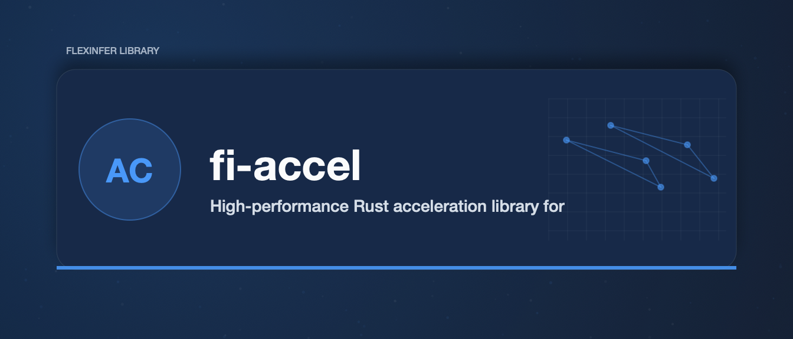

# fi-accel

High-performance Rust acceleration library for agent/MCP workflows.

## Features

- **Token Counting**: 10-50x faster than Python tiktoken
- **Embedding Operations**: SIMD-accelerated similarity calculations (50-100x faster)
- **Fuzzy Diff Matching**: Intelligent patch application for drifted files
- **Log Streaming**: Efficient incremental log reading
- **JSON Parsing**: SIMD-accelerated NDJSON parsing
- **TOML Parsing**: Fast TOML parsing with JSON interop and config merging
- **TOON Parsing**: Token Oriented Object Notation for efficient LLM serialization

## Installation

### Python

```bash
pip install fi-accel
```

### JavaScript/TypeScript (WASM)

```bash
pnpm add @flexinfer/fi-accel
```

## Usage

### Python

```python
from fi_accel import (
    count_tokens,
    truncate_to_tokens,
    split_by_tokens,
    cosine_similarity_matrix,
    FuzzyMatcher,
    LogReader,
    parse_toml,
    merge_toml,
    parse_toon,
    to_toon,
)

# Token counting
tokens = count_tokens("Hello, world!", model="gpt-4")  # 4

# Token-based text splitting
chunks = split_by_tokens(long_text, chunk_size=500, overlap=50, model="gpt-4")

# Embedding similarity
matrix = cosine_similarity_matrix(query_embeddings, doc_embeddings)

# Fuzzy patch application
matcher = FuzzyMatcher(threshold=0.6)
result = matcher.apply_patch(patch_text, file_content)

# Log streaming
reader = LogReader(initial_content)
new_lines = reader.append(new_content)
errors = reader.filter(r"ERROR|WARN")

# TOML parsing
config = parse_toml(toml_string)  # Returns dict
merged = merge_toml(base_config, override_config)  # Deep merge

# TOON parsing (Token Oriented Object Notation)
data = parse_toon("key: value\ncount: 42")  # Returns dict
toon_str = to_toon({"name": "test", "items": [1, 2, 3]})  # Returns TOON string
```

### JavaScript/TypeScript

```typescript
import {
  WasmLogReader,
  parse_ndjson_str,
  cosine_similarity,
  apply_fuzzy_patch,
  parse_toml,
  merge_toml,
  parse_toon,
  to_toon,
} from '@flexinfer/fi-accel';

// Log reader
const reader = new WasmLogReader(initialContent);
const newLines = reader.append(newContent);
const errors = reader.filter('ERROR');

// JSON parsing
const messages = parse_ndjson_str(ndjsonData);

// Similarity
const sim = cosine_similarity([1, 0, 0], [1, 0, 0]); // 1.0

// Fuzzy patch
const result = apply_fuzzy_patch(patch, file, 0.6);

// TOML parsing
const config = parse_toml(tomlString);
const merged = merge_toml(baseToml, overlayToml);

// TOON parsing
const data = parse_toon("key: value\ncount: 42");
const toonStr = to_toon({ name: "test", items: [1, 2, 3] });
```

## Performance

| Operation | Python | fi-accel | Speedup |
|-----------|--------|----------|---------|
| Token count (10KB) | 5ms | 0.1ms | 50x |
| Similarity matrix (1K x 1K) | 2s | 20ms | 100x |
| Fuzzy patch (10K lines) | 500ms | 5ms | 100x |
| NDJSON parse (1MB) | 50ms | 5ms | 10x |
| TOML parse (100KB) | 10ms | 1ms | 10x |
| TOON parse (10KB) | 5ms | 0.5ms | 10x |

## Building from Source

### Prerequisites

- Rust 1.83+
- Python 3.9+ (for PyO3)
- wasm-pack (for WASM)

### Commands

```bash
# Build core library
cargo build --release -p fi-accel-core

# Build Python wheel
cd python && maturin build --release

# Build WASM
cd crates/fi-accel-wasm && wasm-pack build --target bundler --out-dir ../../pkg
```

## License

MIT
